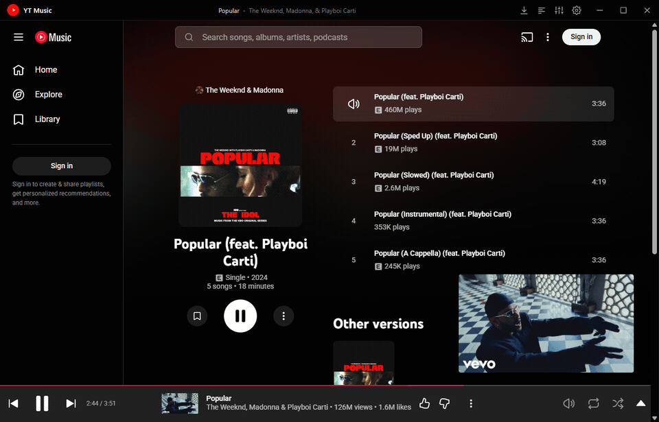
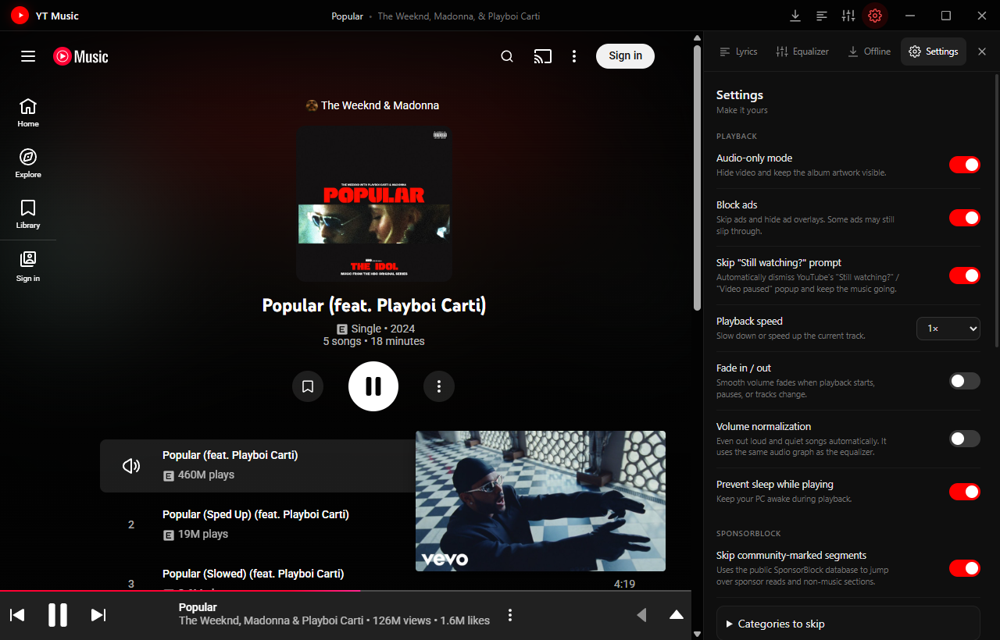

<div align="center">


# YT Music Desktop

**Ad blocking and offline MP3/MP4 downloads for YouTube Music — in a real Windows desktop app.**

Unofficial. Not affiliated with YouTube or Google.

[](https://github.com/altwasntavailable/yt-music-desktop/releases/latest)
[](https://github.com/altwasntavailable/yt-music-desktop/releases)
[](https://github.com/altwasntavailable/yt-music-desktop/actions/workflows/ci.yml)
[](LICENSE)
[](https://github.com/altwasntavailable/yt-music-desktop/releases)

</div>


<div align="center">
  <sub>Ad blocking · offline playlist downloads · lyrics · equalizer · tray playback · sleep/resume recovery</sub>
</div>

## Why YT Music Desktop?

| | |
| --- | --- |
| **Block ads and interruptions** | Network-level filtering, automatic skip, hidden overlays, and automatic “Still watching?” dismissal. |
| **Download music for offline listening** | Save the current track or the current playlist as **M4A**, **MP3**, or **MP4**, with bitrate/quality choices, tags and cover art, SponsorBlock cutting, human-readable filenames, queue progress, and duplicate skipping. |
| **Built to stay alive** | Renderer recovery plus a detached watchdog for main-process hangs after sleep/resume or long background sessions. |
| **A real desktop app** | System tray, media keys, browser-based Google sign-in, lyrics, 10-band equalizer, Discord Rich Presence, taskbar controls, jump lists, notifications, a sleep timer, Start with Windows, and automatic updates. |

> **Ad blocking and offline downloading are best-effort and may conflict with YouTube's Terms of Service.** Use them only for content you are allowed to access or save. See [Ad blocking](#ad-blocking) and [Offline downloads](#offline-downloads).

## Demo



## Install

Download **[the latest release](https://github.com/altwasntavailable/yt-music-desktop/releases/latest)**.

- **Installer:** [YT-Music-Desktop-Setup-1.3.1.exe](https://github.com/altwasntavailable/yt-music-desktop/releases/latest/download/YT-Music-Desktop-Setup-1.3.1.exe)
- **Portable:** [YT-Music-Desktop-Portable-1.3.1.exe](https://github.com/altwasntavailable/yt-music-desktop/releases/latest/download/YT-Music-Desktop-Portable-1.3.1.exe)
- **All releases:** https://github.com/altwasntavailable/yt-music-desktop/releases
- **Verify:** compare each downloaded file with `SHA256SUMS.txt` from the same release.
- **Winget:** manifest prepared in [`packaging/winget`](packaging/winget); submission to the Winget repository is pending.
- **Requirements:** Windows 10/11 x64. `yt-dlp` is required for offline downloads. FFmpeg is required for MP3, tags/cover art, SponsorBlock cutting, and merged MP4; M4A and progressive MP4 work without it. See [Download options](#download-options).
- The installer is not code-signed, so Windows SmartScreen may show a warning. See [Security and privacy](#security-and-privacy).

## Screenshots

<table>
  <tr>
    <td width="50%"><br><sub><b>Ad blocking and interruptions</b></sub></td>
    <td width="50%"><br><sub><b>Current playlist as MP3 or MP4</b></sub></td>
  </tr>
</table>

## Features

- **Ad blocking** — network filtering plus automatic ad skipping, with overlays hidden. Best-effort; see [Ad blocking](#ad-blocking).
- **Offline downloads** - save the current track or playlist as M4A (original audio), MP3 (128-320 kbps or best VBR), or MP4 (480p-1080p or best) with yt-dlp, then play them from the searchable **Offline** library. See [Download options](#download-options).
- **Offline-first** - if YouTube Music fails to load or the player crashes, the error screen offers the **Offline library**, so downloaded music stays playable without the page.
- **No "Still watching?" interruptions** — automatically dismisses YouTube's “Still watching?” / “Video paused” prompt and resumes playback.
- **Your real YouTube Music library** — sign in with Google and use your playlists, liked songs, home feed, search, radio, and queue.
- **Browser-based sign-in** - Google blocks embedded sign-in. The app can import the Google session already signed in to Chrome, Edge, Brave, or Vivaldi, or open a real browser window for sign-in.
- **Audio-only mode** — hides video and keeps album artwork on screen.
- **SponsorBlock** — skips community-submitted sponsor reads, intros, outros, and non-music sections using the public SponsorBlock database.
- **Lyrics panel** — time-synced lyrics from [LRCLIB](https://lrclib.net), with plain-text fallback and a button to open YouTube Music's own lyrics.
- **10-band equalizer** — presets, preamp, and custom bands applied live through Web Audio.
- **Discord Rich Presence** — one click to connect; shows the current song on your Discord profile.
- **System tray** — closing the window keeps the music playing; control playback and panels from the tray.
- **Windows desktop integration** - taskbar thumbnail buttons, jump-list actions and recent downloads, taskbar download progress and completion/error overlays, and optional track notifications while hidden.
- **Automatic crash recovery** — recovers the UI or player renderer if Chromium freezes; a separate watchdog process restarts the app if its main process stops responding.
- **Playback extras** — speed control (0.5×–2×), fade transitions, and automatic volume normalization; the speed setting also applies to offline playback.
- **Diagnostics** — copy app/tool/download status and recent logs, or open the app data and download folders. Nothing is uploaded.
- **Automatic updates** — installed builds check for updates on startup and every six hours; a downloaded update remains visible when you reopen Settings.

## Security and privacy

- [SECURITY.md](SECURITY.md) describes the security model and how to report vulnerabilities privately.
- [PRIVACY.md](PRIVACY.md) lists what is stored locally and which third-party services the app contacts.
- [LICENSE](LICENSE) covers the project under the MIT license.
- Downloaded `yt-dlp` binaries are verified against the official SHA-256 checksum list before the app runs them. In-app updates use yt-dlp's own updater, verify the resulting binary against the same checksum list, and are offered only for the app-managed Windows copy.
- Browser sign-in can import the existing Google/YouTube session from Chrome, Edge, Brave, or Vivaldi with your consent. It copies the selected browser's cookie database and cookie key to a temporary profile, imports only Google/YouTube cookies, and deletes the copy. The real browser profile is never modified. The separate-browser fallback uses a private stdio debugging pipe; it does not open a localhost debugging port while Google session cookies are live.
- IPC handlers only accept calls from the app's own desktop renderer; the embedded YouTube Music page cannot call desktop APIs.
- Offline playback is served through a custom `ytmd-media` protocol that resolves only files in the local download index and streams them with HTTP range support.
- No telemetry, analytics, or developer-operated servers.

## Release integrity

Each release publishes `SHA256SUMS.txt` next to the installer and portable build. The examples below use 1.3.1:

```powershell
certutil -hashfile YT-Music-Desktop-Setup-1.3.1.exe SHA256
```

1.3.1 SHA-256 values:

- Installer: `0ced8ab40a727b58d2928eb1b9e06fde54a3f5ece09327f3b05272dabc15b1f9`
- Portable: `aae1427f3e6666b58122c67b0fbeb9475e3e678b45ec5cb44f883c2d27ae42ca`

Starting with the automated release workflow, builds also attach GitHub build
provenance attestations. Verify one with the GitHub CLI:

```powershell
gh attestation verify YT-Music-Desktop-Setup-1.3.1.exe --repo altwasntavailable/yt-music-desktop
```

Code signing is not configured yet; SmartScreen may warn on first launch. See
[SECURITY.md](SECURITY.md#release-verification).

## First launch

1. Open the app and click **Sign in** in the top-right corner of YouTube Music.
2. Choose **Use browser session** to reuse the Google account already signed in to Chrome, Edge, Brave, or Vivaldi. If that browser is open, close it when prompted so the app can read its local session; then choose **Retry now**. The app imports only Google/YouTube cookies into its own profile and deletes the temporary copy. Nothing is uploaded.
3. If you prefer to sign in directly, choose **Sign in in a browser**. A real Chrome, Edge, Brave, or Vivaldi window opens for the Google sign-in page. Sign in with the Google account that owns your YouTube Music library; the app imports the session when the browser reaches YouTube Music and closes it.
4. The app remembers the session in its own Electron profile, so you only need to sign in once.
5. Click the **Lyrics** button in the app's title bar (or press `Ctrl+L`) while a song is playing.

You can also start this flow manually from **Settings → Account → Sign in with browser**. The app never sees your Google password. Chrome, Edge, Brave, or Vivaldi is required for automatic session import (Edge is included with Windows). The temporary copies are removed after import, and signing out clears both the app session and any remaining sign-in profile.

## Lyrics

The lyrics drawer looks up the current track on LRCLIB:

- **Synced** lyrics highlight the current line and auto-scroll.
- **Plain** lyrics are shown when no timed version exists.
- **Instrumental** tracks are labelled.
- Click any synced line to seek to that part of the song.
- Use **−0.5s** to show lyrics earlier or **+0.5s** to show them later. The buttons follow those labels.
- **YT Music lyrics** opens the official lyrics panel inside the player as a fallback.
- **Search** opens a web search for the track's lyrics.

Lyrics are fetched on the main process and cached in memory. No lyrics are downloaded or written to disk.

## Ad blocking

Ad blocking is enabled by default. Open **Settings → Playback → Block ads** to turn it on or off.

It works in three layers:

- Known ad and tracking endpoints are blocked at the network level.
- When the player reports an ad, the app auto-clicks Skip, calls the player's ad-skip API when available, and fast-forwards the ad video as a fallback.
- Ad overlays are hidden, and the YouTube Music Premium upsell is dismissed.

Some ads may still get through because YouTube serves ad media from the same domains as music. Ad blocking is best-effort and may conflict with YouTube's Terms of Service; use it at your own discretion.

## Equalizer

Open the **Equalizer** button in the title bar or press `Ctrl+E`.

- Enable the switch to connect the player audio to the 10-band equalizer.
- Choose a preset or move individual bands; moving a band switches the preset to **Custom**.
- **Preamp** adjusts overall gain.
- **Reset** returns everything to flat.
- If audio ever stops after enabling the equalizer, use **Reload page** in the equalizer panel. The audio graph is rebuilt on reload.

## Playback extras

Open **Settings → Playback**:

- **Playback speed** — 0.5× to 2×; pitch is preserved.
- **Fade in/out** — short volume ramps when playback starts, pauses, or a track is ending. Uses the same Web Audio graph as the equalizer.
- **Volume normalization** — measures the output level and gently evens out loud and quiet tracks.

Fade and normalization share the equalizer's audio graph. If either option is enabled while the equalizer is off, the app still creates the graph in the background.

## SponsorBlock

SponsorBlock is enabled by default. Open **Settings → SponsorBlock** to choose which segment categories are skipped:

- Sponsor spots, self promotion, and like/subscribe reminders.
- Intros, outros, previews, fillers, and non-music talk.

Segments come from the public <https://sponsor.ajay.app> database and are cached for six hours. The app only seeks within the video; nothing is modified on YouTube. Community submissions can occasionally be wrong, so use the category switches to tune it.

You can leave every category unchecked. SponsorBlock stays enabled but skips nothing; an empty category list is a valid setting.

## Offline downloads

Open the **Offline** drawer tab, use the download menu in the title bar, or press `Ctrl+Shift+D` to save music. Downloads require [yt-dlp](https://github.com/yt-dlp/yt-dlp):

1. Click **Install yt-dlp** in the Offline panel to fetch `yt-dlp.exe` into the app's data folder. The panel shows the installed version and offers **Update yt-dlp** when the app manages the binary.
2. Alternatively, put `yt-dlp.exe` on your `PATH` or set `YTMD_YTDLP_PATH` to its location. In-app updates only apply to the app-managed copy; update an external copy with its package manager.
3. Choose **Current track** or **Current playlist**, then pick **M4A**, **MP3**, or **MP4**.
4. Play downloaded tracks from the **Offline** panel. The app pauses YouTube playback and shows a small offline player bar over the page.

### Offline-first

If YouTube Music fails to load, crashes, or you are offline, the error screen offers **Offline library** next to **Try again**. Downloaded tracks are served by the app's local media protocol, so they stay playable without the YouTube Music page.

### Download options

The format you pick controls the file. **Download options** in the dialog adjusts quality, tags, and SponsorBlock cutting for that download; **Settings → Downloads** sets the defaults and the download folder.

| Format | What it saves | FFmpeg |
| --- | --- | --- |
| **M4A** | The original audio stream when available, with no re-encoding; otherwise the source audio container is kept | Not required |
| **MP3** | Audio converted to MP3 at 128, 192, 256, or 320 kbps, or best VBR (V0) | Required |
| **MP4** | Video at 480p, 720p, 1080p, or best available | Required for a merged high-quality file; without it the app saves a progressive MP4 that may be lower quality |

- **Download folder** — change it in **Settings → Downloads** or from the folder row in the **Offline** panel. New downloads go to the new folder. Existing downloads stay where they are and remain playable.
- **Tags and cover art** — audio downloads can embed title, artist, album, and artwork; video downloads can embed tags. This requires FFmpeg.
- **Cut SponsorBlock segments** — removes the selected SponsorBlock categories from the downloaded copy. It uses the same category selection as playback and requires FFmpeg.
- **FFmpeg** — put `ffmpeg.exe` on your `PATH`, in the app's `tools` folder, or point `YTMD_FFMPEG_PATH` to it. Without it, MP3, tags/cover art, SponsorBlock cutting, and merged MP4 are unavailable; M4A and progressive MP4 still work.

### Offline library

The **Offline** panel lists every downloaded track:

- Search by title, artist, album, or playlist.
- Filter to **All**, **Audio**, or **Video**; sort by newest, title, artist, or largest.
- See the total track count and disk size, plus duration, size, format, and playlist for each track.
- Play or pause a track, show it in Explorer, or delete it.
- Cancel an in-progress track or playlist from the progress row.
- Retry the last failed track from the **Last error** row; retryable partial files resume instead of starting over.
- Open the download log or the active download folder from the header buttons.

Playlist downloads run one track at a time, skip tracks that are already saved, and add each track to the library as soon as it finishes, so you can start listening before the whole playlist is done.

### Offline player

The offline bar has previous/next, play/pause, shuffle, repeat, a queue position (`3 / 12`), and a seek bar. It follows the playback speed in **Settings → Playback**. Windows media-session metadata and actions are published, so hardware media keys and the Windows media overlay control the offline track. Playback state is also sent to the tray, Discord Rich Presence, and the power blocker used for **Prevent sleep while playing**.

Each download is saved as `Artist - Title.ext`, so the file name matches the track; duplicate names get a suffix. Files are stored in the active download folder (`%APPDATA%\YT Music Desktop\downloads` by default), and the download log lives in that folder. Downloads continue while the app is in the tray, and the app keeps the system awake while a download is active. Cancelled downloads are removed; retryable failures deliberately keep their partial files so a later retry can resume instead of starting over.

**If the folder looks empty:** playlist downloads run one track at a time, so each file is added to the library as it finishes. If there is no progress, check the **Last error** line in the Offline panel or open the download log from the Offline header.

> Offline downloading may conflict with YouTube's Terms of Service and the rights of content owners. Use it only for content you are allowed to save, and at your own discretion.

## Automatic updates

Installed builds check for updates 20 seconds after launch and then every six hours. Open **Settings → About → Updates** to check manually. When an update finishes downloading, a **Restart & install update** button appears, and it stays visible after closing and reopening Settings until you install it. Portable builds do not self-update; download a newer portable executable from the releases page.

To publish updates, set the `build.publish` fields in `package.json` to your GitHub repository (owner/repo), then build with `npm run dist` and upload the generated installer, blockmap, and `latest.yml` to a release. This repository is configured for `altwasntavailable/yt-music-desktop`. For a generic HTTPS host instead, launch the app with `YTMD_UPDATE_URL=https://your-host/updates/`; the variable is read at runtime. Only HTTPS feed URLs are accepted (plain HTTP is allowed for localhost). In development, update checks are disabled because there is no installed `app-update.yml`.

## Discord Rich Presence

1. Start Discord.
2. Open **Settings → Discord Rich Presence** and click **Connect to Discord**.

That's it. The app ships with a shared **YouTube Music** Discord application, so you do not need to create one. Your profile shows the current song, artist, album art, playback progress, and a **Listen on YouTube Music** button. It clears during ads.

The connection is automatic: once connected, the app reconnects when Discord restarts and retries every 15 seconds if Discord is not running yet. Click **Disconnect** to turn it off.

**Advanced:** to use your own app name or icon, open **Advanced** in the Discord settings, enable **Use my own Discord Application ID**, and paste an ID from <https://discord.com/developers/applications>. The shared default is used otherwise.

## System tray

- The **X** button hides the app to the tray and keeps playback alive.
- Click the tray icon to bring the window back.
- Right-click the tray icon for Play/Pause, Next, Previous, Lyrics, Equalizer, Settings, and Quit.
- Disable **Close to tray** in Settings if you want the X button to quit instead.

## Windows desktop integration

- **Taskbar thumbnail buttons** — Previous, Play/Pause, Next, Download current track, and Settings.
- **Jump list** — Play/Pause, Lyrics, Offline downloads, Settings, Download current track, recent downloads (up to five), and Quit.
- **Taskbar progress and overlays** — a progress bar during downloads and a completion or error overlay when a download or playlist job finishes.
- **Track notifications** — optional Windows notifications when the track changes while the app is hidden or in the background. Turn them off under **Settings → Desktop → Track notifications**.
- **Sleep timer** — choose 15–90 minutes under **Settings → Desktop**; when it expires, playback pauses. It does not suspend Windows.
- **Start with Windows** — launch the installed app hidden in the tray. This uses the Windows login item and is ignored by unpacked development builds.

## Diagnostics

Open **Settings → About → Diagnostics** to copy a report with the app, Electron, tool, and download status plus the last 60 lines of the download and watchdog logs. The same area can open the app data folder. The **Offline** panel has buttons for the download log and the active download folder.

The report is copied to the clipboard; nothing is uploaded. Review it before posting publicly.

## Keyboard shortcuts

| Shortcut | Action |
| --- | --- |
| `Ctrl+L` | Toggle lyrics |
| `Ctrl+E` | Toggle equalizer |
| `Ctrl+,` | Toggle settings |
| `Ctrl+Shift+D` | Download the current track |
| `Ctrl+Shift+O` | Toggle the Offline panel |
| `Ctrl+W` | Close/hide the window |
| `Ctrl+R` | Reload the YouTube Music player |
| `Ctrl+Shift+R` | Reload the app window |
| `F11` | Fullscreen |
| `Alt+Left` | Go back in the embedded player |
| `Esc` | Close the open drawer, download dialog, or download menu |

The offline player's previous/next, shuffle, and repeat controls are buttons in the offline bar; they do not have app keyboard shortcuts. Hardware media keys work through the Windows media session.

## Build from source

Requirements: Node.js 20+ and npm.

```bash
npm install
npm test              # run the Node unit tests
npm start             # run the app
npm run dev           # run with dev logging/context menu inspection
npm run dist          # build the Windows NSIS installer into dist/
npm run dist:portable # build the portable executable into dist/
npm run pack          # build an unpacked app into dist/win-unpacked/
```

The icon assets, taskbar thumbnail icons, and taskbar overlay icons are generated by `scripts/generate-icons.js` (pure JS, no native image dependencies). The build scripts regenerate them before packaging.

## Contributing

Issues and pull requests are welcome. Start with [CONTRIBUTING.md](CONTRIBUTING.md), and use the issue templates for bugs and feature requests. Security reports should use the private vulnerability reporting link in [SECURITY.md](SECURITY.md).

## Project structure

```text
src/main/main.js             Electron main process, windows, IPC, media protocol
src/main/watchdog.js         Detached process watchdog for main-process hangs
src/main/browser-auth.js     Browser-based Google sign-in and cookie import
src/main/config.js           JSON settings store
src/main/download-utils.js   Pure M4A/MP3/MP4 format, filename, and argument helpers
src/main/downloads.js        yt-dlp/FFmpeg management, downloads, and offline library
src/main/desktop-integration.js  Taskbar, jump list, notifications, sleep timer, login item
src/main/sponsorblock.js     SponsorBlock segment lookup and cache
src/main/updater.js          electron-updater integration
src/main/lyrics.js           LRCLIB lookup, matching, and cache
src/main/discord.js          Discord Rich Presence client
src/main/tray.js             Tray icon and menu
src/preload/chrome-preload.js  Safe IPC bridge for the desktop chrome
src/renderer/index.html      Desktop chrome + drawer UI
src/renderer/styles.css      YT Music-inspired theme
src/renderer/app.js          Player polling, lyrics UI, equalizer, settings, offline UI
test/                        Node unit tests for download helpers and desktop integration
scripts/generate-icons.js    Icon generator
assets/                      App and tray icons
assets/thumbar/              Taskbar thumbnail toolbar icons
assets/overlays/             Taskbar completion/error overlay icons
build/                       Installer icon resources
SECURITY.md                  Security model and private reporting
PRIVACY.md                   Local data and third-party services
CHANGELOG.md                 Release history
CONTRIBUTING.md              Development setup and pull-request guidance
docs/                        Screenshots, demo GIF, social preview
packaging/winget/            Winget manifest for package-manager installs
.github/                     CI, release automation, issue templates, Dependabot
```

## Notes and limitations

- This is an unofficial client and is not affiliated with YouTube or Google.
- Playback normally goes through the official YouTube Music player. Optional offline copies are downloaded with yt-dlp at the user's request and stay on the local device.
- **M4A** keeps the audio stream YouTube provides; **MP3** re-encodes it and can lose some quality. **MP4** without FFmpeg uses a single progressive stream, which may be lower quality than a merged file.
- Tags/cover art and SponsorBlock cutting modify only the local downloaded copy. They do not change anything on YouTube.
- Changing the download folder does not move existing downloads. They stay in their original folder and remain playable; new downloads go to the new folder.
- In-app `yt-dlp` updates are available only for the app-managed Windows copy. External copies must be updated with their package manager.
- Taskbar thumbnail buttons, jump lists, and Start with Windows are Windows-only. Start with Windows is applied by installed builds, not unpacked development runs.
- Offline downloads and ad/skip features may conflict with YouTube's Terms of Service. Use them at your own discretion.
- Audio-only mode hides video visually. For music-video tracks, YouTube may still stream video data in the background.
- The lyrics fallback is LRCLIB; coverage depends on their database. The **YT Music lyrics** button uses the site's own lyrics when available.
- Ad blocking is best-effort. YouTube can change how ads are delivered at any time, so some ads may still appear. Blocking ads may conflict with YouTube's Terms of Service.
- Browser sign-in requires Chrome, Edge, Brave, or Vivaldi for automatic session import. Edge is included with Windows. The app never sees your password. If you choose to import an existing session, the app reads a temporary copy of the browser's cookie database and imports only Google/YouTube cookies; the real browser profile is not modified.
- Google may occasionally change its sign-in or YouTube Music internals. Since this app wraps the official player, most site updates are picked up automatically.
- Discord Rich Presence uses a shared public **YouTube Music** Discord application by default. You can use your own Application ID under **Settings → Discord → Advanced** if you prefer a custom name or icon.
- The current installer is not code-signed. Releases include SHA-256 checksums, but Windows SmartScreen may still warn. Code signing can be enabled later by configuring the standard electron-builder `CSC_LINK` / `CSC_KEY_PASSWORD` environment variables.

## Troubleshooting

**The window is blank or shows a load error**
Check your internet connection and click **Try again**. The app loads `music.youtube.com` in an embedded Chromium view. If you are offline or the page will not load, click **Offline library** on the error screen to play downloaded tracks.

**The app was left in the background and seems frozen**
The app watches both renderers and automatically restarts them if Chromium stops responding, including after the system wakes from sleep. A separate watchdog process also restarts the app if its main process hangs. If you need to force it manually, use **Reload window** or **Reload player** from the tray menu, or press `Ctrl+R` to reload the player and `Ctrl+Shift+R` to reload the app window. Watchdog restarts are logged to `watchdog.log` in the app’s user-data folder.

**Google says the browser may not be secure**
This is Google rejecting a browser with an automation/debugging signal. The app now offers to import the existing Chrome/Edge/Brave/Vivaldi session instead, and the separate sign-in window disables that signal while keeping the private pipe. If import says the browser is still running, close all Chrome/Edge windows and choose **Retry now**. If no saved session is found, sign in to YouTube Music in that browser first or choose the separate browser sign-in.

**No lyrics appear**
LRCLIB may not have that track. Click **YT Music lyrics** to use YouTube Music's own lyrics, or **Search** to find them on the web.

**Audio is silent after enabling the equalizer**
Open the equalizer and click **Reload page**. This rebuilds the audio graph and restores normal playback.

**Discord status says "Discord is not running"**
Start Discord, then wait for the automatic retry (every 15 seconds) or click **Try again** next to the status.

**Discord says connected, but nothing appears on my profile**
In Discord, open **User Settings → Activity Privacy** and enable **Display current activity as a status message**.

**Offline downloads say yt-dlp is required**
Open the **Offline** panel and click **Install yt-dlp**. The panel shows the installed version. If the app manages `yt-dlp.exe`, use **Update yt-dlp** to refresh it; if you supplied your own copy with `YTMD_YTDLP_PATH` or `PATH`, update it with its package manager.

**MP3 is unavailable in the download dialog**
MP3 conversion needs FFmpeg. Install FFmpeg and make sure `ffmpeg -version` works in a terminal, or set `YTMD_FFMPEG_PATH` to the executable. M4A downloads keep the original audio and work without FFmpeg. MP4 downloads also work without FFmpeg but use a single progressive stream, which may be lower quality.

**Tags, cover art, or SponsorBlock cutting are unavailable**
Those options need FFmpeg. The same FFmpeg installation used for MP3 also handles tagging, cover art, SponsorBlock cutting, and MP4 merging. Downloads still succeed without it; the optional steps are skipped.

**The downloads folder looks empty**
Playlist downloads run one track at a time; each track is added to the library as it finishes. If the Offline panel shows no progress and no files appear, check the **Last error** line there or open the download log from the Offline header. The folder button opens the active download folder (`%APPDATA%\YT Music Desktop\downloads` by default).

**I changed the download folder and my old files are still in the old folder**
Changing the folder does not move existing files. The library stores their full paths, so they remain playable. New downloads go to the new folder. Switch back with **Change** if you want to keep everything in one place.

**A download fails immediately**
YouTube sometimes rejects requests from yt-dlp until it updates. Use **Update yt-dlp** in the Offline panel (app-managed copy), or update your external copy. The last yt-dlp error is shown in the Offline panel and written to the download log.

**The app opened with no window**
**Start with Windows** launches the installed app hidden in the tray. Click the tray icon to show it. The option is ignored by unpacked development builds.

**Check for updates does nothing**
Automatic updates only work in a packaged/installed build. In development, the app reports that updates are unavailable. For your own builds, update the `build.publish` owner/repo in `package.json` or set `YTMD_UPDATE_URL`.

## Support the project

If YT Music Desktop is useful to you:

- Star the repository so other people can find it.
- Share it with someone who lives in a YouTube Music browser tab.
- Report bugs with the app version and the relevant log from `%APPDATA%\YT Music Desktop`.
- Suggest features in the issue tracker — download and desktop-integration ideas are especially welcome.

Ad blocking and offline downloading are the two features most people come for. Keeping those reliable is the priority.
