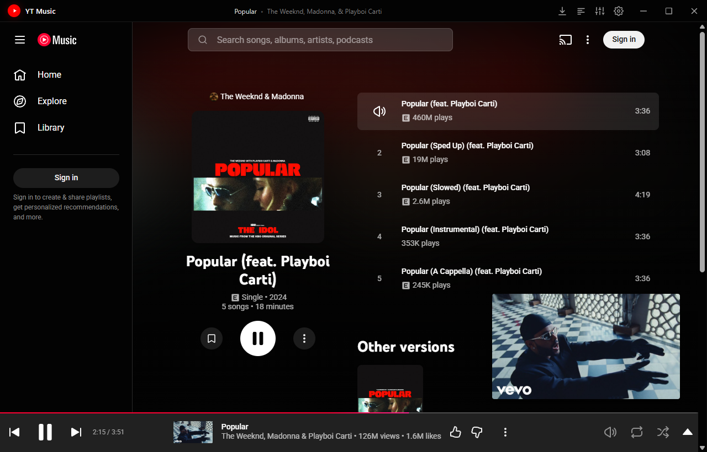
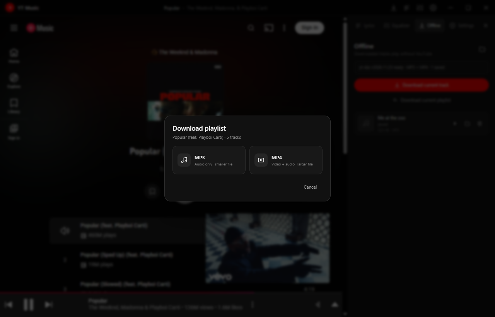

<div align="center">


# YT Music Desktop

**Ad blocking and offline MP3/MP4 downloads for YouTube Music — in a real Windows desktop app.**

Unofficial. Not affiliated with YouTube or Google.

[](https://github.com/altwasntavailable/yt-music-desktop/releases/latest)
[](https://github.com/altwasntavailable/yt-music-desktop/releases)
[](https://github.com/altwasntavailable/yt-music-desktop/actions/workflows/ci.yml)
[](LICENSE)
[](https://github.com/altwasntavailable/yt-music-desktop/releases)

</div>



<div align="center">
  <sub>Ad blocking · offline playlist downloads · lyrics · equalizer · tray playback · sleep/resume recovery</sub>
</div>

## Why YT Music Desktop?

| | |
| --- | --- |
| **Block ads and interruptions** | Network-level filtering, automatic skip, hidden overlays, and automatic “Still watching?” dismissal. |
| **Download music for offline listening** | Save the current track or the current playlist as **MP3** or **MP4**. Human-readable filenames, queue progress, and duplicate skipping. |
| **Built to stay alive** | Renderer recovery plus a detached watchdog for main-process hangs after sleep/resume or long background sessions. |
| **A real desktop app** | System tray, media keys, browser-based Google sign-in, lyrics, 10-band equalizer, Discord Rich Presence, and automatic updates. |

> **Ad blocking and offline downloading are best-effort and may conflict with YouTube's Terms of Service.** Use them only for content you are allowed to access or save. See [Ad blocking](#ad-blocking) and [Offline downloads](#offline-downloads).

## Demo


## Install

Download **[the latest release](https://github.com/altwasntavailable/yt-music-desktop/releases/latest)**.

- **Installer:** [YT-Music-Desktop-Setup-1.2.1.exe](https://github.com/altwasntavailable/yt-music-desktop/releases/latest/download/YT-Music-Desktop-Setup-1.2.1.exe)
- **Portable:** [YT-Music-Desktop-Portable-1.2.1.exe](https://github.com/altwasntavailable/yt-music-desktop/releases/latest/download/YT-Music-Desktop-Portable-1.2.1.exe)
- **All releases:** https://github.com/altwasntavailable/yt-music-desktop/releases
- **Verify:** compare the installer with `SHA256SUMS.txt` from the same release.
- **Winget:** manifest prepared in [`packaging/winget`](packaging/winget); submission to the Winget repository is pending.
- **Requirements:** Windows 10/11 x64. `yt-dlp` is required for offline downloads; FFmpeg is required for MP3 conversion.
- The installer is not code-signed, so Windows SmartScreen may show a warning. See [Security and privacy](#security-and-privacy).

## Screenshots

<table>
  <tr>
    <td width="50%"><br><sub><b>Ad blocking and interruptions</b></sub></td>
    <td width="50%"><br><sub><b>Current playlist as MP3 or MP4</b></sub></td>
  </tr>
</table>

## Features

- **Ad blocking** — network filtering plus automatic ad skipping, with overlays hidden. Best-effort; see [Ad blocking](#ad-blocking).
- **Offline downloads** — save the current track or playlist as MP3/MP4 with yt-dlp, then play downloaded tracks inside the app from the **Offline** panel.
- **No "Still watching?" interruptions** — automatically dismisses YouTube's “Still watching?” / “Video paused” prompt and resumes playback.
- **Your real YouTube Music library** — sign in with Google and use your playlists, liked songs, home feed, search, radio, and queue.
- **Browser-based sign-in** — Google blocks embedded sign-in, so the app opens a real Chrome/Edge window and imports the session automatically.
- **Audio-only mode** — hides video and keeps album artwork on screen.
- **SponsorBlock** — skips community-submitted sponsor reads, intros, outros, and non-music sections using the public SponsorBlock database.
- **Lyrics panel** — time-synced lyrics from [LRCLIB](https://lrclib.net), with plain-text fallback and a button to open YouTube Music's own lyrics.
- **10-band equalizer** — presets, preamp, and custom bands applied live through Web Audio.
- **Discord Rich Presence** — one click to connect; shows the current song on your Discord profile.
- **System tray** — closing the window keeps the music playing; control playback and panels from the tray.
- **Automatic crash recovery** — recovers the UI or player renderer if Chromium freezes; a separate watchdog process restarts the app if its main process stops responding.
- **Playback extras** — speed control (0.5×–2×), fade transitions, and automatic volume normalization.
- **Automatic updates** — installed builds check for updates on startup and every six hours.

## Security and privacy

- [SECURITY.md](SECURITY.md) describes the security model and how to report vulnerabilities privately.
- [PRIVACY.md](PRIVACY.md) lists what is stored locally and which third-party services the app contacts.
- [LICENSE](LICENSE) covers the project under the MIT license.
- Downloaded `yt-dlp` binaries are verified against the official SHA-256 checksum list before the app runs them.
- No telemetry, analytics, or developer-operated servers.

## Release integrity

Each release publishes `SHA256SUMS.txt` next to the installer and portable build:

```powershell
certutil -hashfile YT-Music-Desktop-Setup-1.2.1.exe SHA256
```

Starting with the automated release workflow, builds also attach GitHub build
provenance attestations. Verify one with the GitHub CLI:

```powershell
gh attestation verify YT-Music-Desktop-Setup-1.2.1.exe --repo altwasntavailable/yt-music-desktop
```

Code signing is not configured yet; SmartScreen may warn on first launch. See
[SECURITY.md](SECURITY.md#release-verification).

## First launch

1. Open the app and click **Sign in** in the top-right corner of YouTube Music.
2. Google blocks sign-in inside embedded browser shells, so the app opens a real Chrome or Edge window for the Google sign-in page.
3. Sign in with the Google account that owns your YouTube Music library. When the browser reaches YouTube Music, the app imports the Google/YouTube session cookies into its own profile, closes the browser, and reloads your library.
4. The app remembers the session in its own Electron profile, so you only need to sign in once.
5. Click the **Lyrics** button in the app's title bar (or press `Ctrl+L`) while a song is playing.

You can also start this flow manually from **Settings → Account → Sign in with browser**. The app never sees your Google password; it only reads the cookies from the browser profile it opened. Chrome or Edge is required for automatic session import (Edge is included with Windows). Signing out clears both the app session and the dedicated browser sign-in profile.

## Lyrics

The lyrics drawer looks up the current track on LRCLIB:

- **Synced** lyrics highlight the current line and auto-scroll.
- **Plain** lyrics are shown when no timed version exists.
- **Instrumental** tracks are labelled.
- Click any synced line to seek to that part of the song.
- Use **−0.5s / +0.5s** to fix lyrics that run early or late.
- **YT Music lyrics** opens the official lyrics panel inside the player as a fallback.
- **Search** opens a web search for the track's lyrics.

Lyrics are fetched on the main process and cached in memory. No lyrics are downloaded or written to disk.

## Ad blocking

Ad blocking is enabled by default. Open **Settings → Playback → Block ads** to turn it on or off.

It works in three layers:

- Known ad and tracking endpoints are blocked at the network level.
- When the player reports an ad, the app auto-clicks Skip, calls the player's ad-skip API when available, and fast-forwards the ad video as a fallback.
- Ad overlays are hidden, and the YouTube Music Premium upsell is dismissed.

Some ads may still get through because YouTube serves ad media from the same domains as music. Ad blocking is best-effort and may conflict with YouTube's Terms of Service; use it at your own discretion.

## Equalizer

Open the **Equalizer** button in the title bar or press `Ctrl+E`.

- Enable the switch to connect the player audio to the 10-band equalizer.
- Choose a preset or move individual bands; moving a band switches the preset to **Custom**.
- **Preamp** adjusts overall gain.
- **Reset** returns everything to flat.
- If audio ever stops after enabling the equalizer, use **Reload page** in the equalizer panel. The audio graph is rebuilt on reload.

## Playback extras

Open **Settings → Playback**:

- **Playback speed** — 0.5× to 2×; pitch is preserved.
- **Fade in/out** — short volume ramps when playback starts, pauses, or a track is ending. Uses the same Web Audio graph as the equalizer.
- **Volume normalization** — measures the output level and gently evens out loud and quiet tracks.

Fade and normalization share the equalizer's audio graph. If either option is enabled while the equalizer is off, the app still creates the graph in the background.

## SponsorBlock

SponsorBlock is enabled by default. Open **Settings → SponsorBlock** to choose which segment categories are skipped:

- Sponsor spots, self promotion, and like/subscribe reminders.
- Intros, outros, previews, fillers, and non-music talk.

Segments come from the public <https://sponsor.ajay.app> database and are cached for six hours. The app only seeks within the video; nothing is modified on YouTube. Community submissions can occasionally be wrong, so use the category switches to tune it.

## Offline downloads

Open the **Offline** drawer tab, use the download menu in the title bar, or press `Ctrl+Shift+D` to save music. Downloads require [yt-dlp](https://github.com/yt-dlp/yt-dlp):

1. Click **Install yt-dlp** in the Offline panel to fetch `yt-dlp.exe` into the app's data folder.
2. Alternatively, put `yt-dlp.exe` on your `PATH` or set `YTMD_YTDLP_PATH` to its location.
3. Choose **Current track** or **Current playlist**, then pick **MP3** or **MP4**.
4. Play downloaded tracks with the play button. The app pauses YouTube playback and shows a small offline player bar over the page.

Each download is saved as `Artist - Title.ext`, so the file name matches the track. Playlist downloads run one track at a time, skip tracks that are already saved, and show aggregate progress in the Offline panel.

**MP3 conversion requires FFmpeg** and will be unavailable if the app cannot find it. **MP4** uses FFmpeg for the best video/audio merge when available; without FFmpeg it falls back to a lower-quality progressive MP4. Put `ffmpeg.exe` on your `PATH`, in the app's `tools` folder, or point `YTMD_FFMPEG_PATH` to it.

Files are stored in the app's downloads folder (use the folder button in the Offline panel to open it). Downloads continue while the app is in the tray, and cancelled or failed downloads are cleaned up.

**If the folder looks empty:** playlist downloads run one track at a time, so files appear as each track finishes. If there is no progress, check the **Last error** line in the Offline panel or `%APPDATA%\YT Music Desktop\downloads\downloads.log`.

> Offline downloading may conflict with YouTube's Terms of Service and the rights of content owners. Use it only for content you are allowed to save, and at your own discretion.

## Automatic updates

Installed builds check for updates 20 seconds after launch and then every six hours. Open **Settings → About → Updates** to check manually. When an update finishes downloading, a **Restart & install update** button appears.

To publish updates, set the `build.publish` fields in `package.json` to your GitHub repository (owner/repo), then build with `npm run dist` and upload the generated installer, blockmap, and `latest.yml` to a release. This repository is configured for `altwasntavailable/yt-music-desktop`. For a generic HTTPS host instead, launch the app with `YTMD_UPDATE_URL=https://your-host/updates/`, or set the same URL in the environment before building. In development, update checks are disabled because there is no installed `app-update.yml`.

## Discord Rich Presence

1. Start Discord.
2. Open **Settings → Discord Rich Presence** and click **Connect to Discord**.

That's it. The app ships with a shared **YouTube Music** Discord application, so you do not need to create one. Your profile shows the current song, artist, album art, playback progress, and a **Listen on YouTube Music** button. It clears during ads.

The connection is automatic: once connected, the app reconnects when Discord restarts and retries every 15 seconds if Discord is not running yet. Click **Disconnect** to turn it off.

**Advanced:** to use your own app name or icon, open **Advanced** in the Discord settings, enable **Use my own Discord Application ID**, and paste an ID from <https://discord.com/developers/applications>. The shared default is used otherwise.

## System tray

- The **X** button hides the app to the tray and keeps playback alive.
- Click the tray icon to bring the window back.
- Right-click the tray icon for Play/Pause, Next, Previous, Lyrics, Equalizer, Settings, and Quit.
- Disable **Close to tray** in Settings if you want the X button to quit instead.

## Keyboard shortcuts

| Shortcut | Action |
| --- | --- |
| `Ctrl+L` | Toggle lyrics |
| `Ctrl+E` | Toggle equalizer |
| `Ctrl+,` | Toggle settings |
| `Ctrl+Shift+D` | Download the current track |
| `Ctrl+Shift+O` | Toggle the Offline panel |
| `Ctrl+W` | Close/hide the window |
| `F11` | Fullscreen |
| `Alt+Left` | Go back in the embedded player |
| `Esc` | Close the open drawer |

## Build from source

Requirements: Node.js 20+ and npm.

```bash
npm install
npm start             # run the app
npm run dev           # run with dev logging/context menu inspection
npm run dist          # build the Windows NSIS installer into dist/
npm run dist:portable # build the portable executable into dist/
npm run pack          # build an unpacked app into dist/win-unpacked/
```

The icon assets are generated by `scripts/generate-icons.js` (pure JS, no native image dependencies). The build scripts regenerate them before packaging.

## Contributing

Issues and pull requests are welcome. Start with [CONTRIBUTING.md](CONTRIBUTING.md), and use the issue templates for bugs and feature requests. Security reports should use the private vulnerability reporting link in [SECURITY.md](SECURITY.md).

## Project structure

```text
src/main/main.js             Electron main process, windows, tray, IPC
src/main/watchdog.js         Detached process watchdog for main-process hangs
src/main/browser-auth.js     Browser-based Google sign-in and cookie import
src/main/config.js           JSON settings store
src/main/downloads.js        yt-dlp/FFmpeg detection, MP3/MP4 and playlist downloads
src/main/sponsorblock.js     SponsorBlock segment lookup and cache
src/main/updater.js          electron-updater integration
src/main/lyrics.js           LRCLIB lookup, matching, and cache
src/main/discord.js          Discord Rich Presence client
src/main/tray.js             Tray icon and menu
src/preload/chrome-preload.js  Safe IPC bridge for the desktop chrome
src/renderer/index.html      Desktop chrome + drawer UI
src/renderer/styles.css      YT Music-inspired theme
src/renderer/app.js          Player polling, lyrics UI, equalizer, settings
scripts/generate-icons.js    Icon generator
assets/                      App and tray icons
build/                       Installer icon resources
SECURITY.md                  Security model and private reporting
PRIVACY.md                   Local data and third-party services
CHANGELOG.md                 Release history
CONTRIBUTING.md              Development setup and pull-request guidance
docs/                        Screenshots, demo GIF, social preview
packaging/winget/            Winget manifest for package-manager installs
.github/                     CI, release automation, issue templates, Dependabot
```

## Notes and limitations

- This is an unofficial client and is not affiliated with YouTube or Google.
- Playback normally goes through the official YouTube Music player. Optional offline copies are downloaded with yt-dlp at the user's request and stay on the local device.
- Offline downloads and ad/skip features may conflict with YouTube's Terms of Service. Use them at your own discretion.
- Audio-only mode hides video visually. For music-video tracks, YouTube may still stream video data in the background.
- The lyrics fallback is LRCLIB; coverage depends on their database. The **YT Music lyrics** button uses the site's own lyrics when available.
- Ad blocking is best-effort. YouTube can change how ads are delivered at any time, so some ads may still appear. Blocking ads may conflict with YouTube's Terms of Service.
- Browser sign-in requires Chrome, Edge, Brave, or another Chromium browser for automatic session import. Edge is included with Windows. The app uses a dedicated browser profile, not your everyday browser profile, and never sees your password.
- Google may occasionally change its sign-in or YouTube Music internals. Since this app wraps the official player, most site updates are picked up automatically.
- Discord Rich Presence uses a shared public **YouTube Music** Discord application by default. You can use your own Application ID under **Settings → Discord → Advanced** if you prefer a custom name or icon.
- The current installer is not code-signed. Releases include SHA-256 checksums, but Windows SmartScreen may still warn. Code signing can be enabled later by configuring the standard electron-builder `CSC_LINK` / `CSC_KEY_PASSWORD` environment variables.

## Troubleshooting

**The window is blank or shows a load error**  
Check your internet connection and click **Try again**. The app loads `music.youtube.com` in an embedded Chromium view.

**The app was left in the background and seems frozen**  
The app watches both renderers and automatically restarts them if Chromium stops responding, including after the system wakes from sleep. A separate watchdog process also restarts the app if its main process hangs. If you need to force it manually, use **Reload window** or **Reload player** from the tray menu, or press `Ctrl+R` to reload the player and `Ctrl+Shift+R` to reload the app window. Watchdog restarts are logged to `watchdog.log` in the app’s user-data folder.

**Google says the browser may not be secure**  
This is expected when Google blocks embedded sign-in. The app now re-routes Google sign-in to a real Chrome/Edge window and imports the session automatically. If the browser window does not open, use **Settings → Account → Sign in with browser**, or make sure Chrome or Edge is installed.

**No lyrics appear**  
LRCLIB may not have that track. Click **YT Music lyrics** to use YouTube Music's own lyrics, or **Search** to find them on the web.

**Audio is silent after enabling the equalizer**  
Open the equalizer and click **Reload page**. This rebuilds the audio graph and restores normal playback.

**Discord status says "Discord is not running"**  
Start Discord, then wait for the automatic retry (every 15 seconds) or click **Try again** next to the status.

**Discord says connected, but nothing appears on my profile**  
In Discord, open **User Settings → Activity Privacy** and enable **Display current activity as a status message**.

**Offline downloads say yt-dlp is required**  
Open the **Offline** panel and click **Install yt-dlp**, or install it separately and make sure `yt-dlp --version` works in a terminal. If you prefer a custom location, set the `YTMD_YTDLP_PATH` environment variable to the executable before starting the app.

**MP3 is disabled in the download dialog**  
MP3 conversion needs FFmpeg. Install FFmpeg and make sure `ffmpeg -version` works in a terminal, or set `YTMD_FFMPEG_PATH` to the executable. MP4 downloads still work without FFmpeg but use a lower-quality progressive stream.

**The downloads folder looks empty**  
Playlist downloads run one track at a time; files appear as each track finishes. If the Offline panel shows no progress and no files appear, check the **Last error** line there or open `%APPDATA%\YT Music Desktop\downloads\downloads.log`. The folder button opens `%APPDATA%\YT Music Desktop\downloads`.

**A download fails immediately**  
YouTube sometimes rejects requests from yt-dlp until it updates. Try again, or update `yt-dlp.exe` from its GitHub releases page. The last yt-dlp error is shown in the Offline panel and written to `downloads.log`.

**Check for updates does nothing**  
Automatic updates only work in a packaged/installed build. In development, the app reports that updates are unavailable. For your own builds, update the `build.publish` owner/repo in `package.json` or set `YTMD_UPDATE_URL`.

## Support the project

If YT Music Desktop is useful to you:

- Star the repository so other people can find it.
- Share it with someone who lives in a YouTube Music browser tab.
- Report bugs with the app version and the relevant log from `%APPDATA%\YT Music Desktop`.
- Suggest features in the issue tracker — download and desktop-integration ideas are especially welcome.

Ad blocking and offline downloading are the two features most people come for. Keeping those reliable is the priority.
